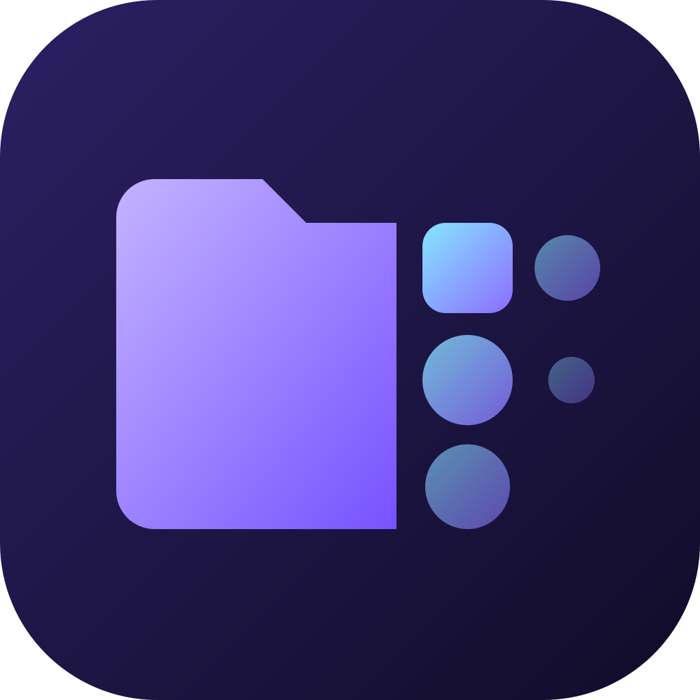

<p align="center">
  
</p>

<h1 align="center">Morfa</h1>

<p align="center">
  A fast, keyboard-first file manager that also converts your files and keeps your cloud close.<br>
  Linux · Windows · macOS
</p>

<p align="center">
  <b>English</b> · <a href="README.ru.md">Русский</a>
</p>

<p align="center">
  <a href="https://github.com/Stevfler/morfa/releases/latest">Download</a> ·
  <a href="docs/BUILDING.md">Build from source</a> ·
  <a href="docs/ROADMAP.md">Roadmap</a> ·
  <a href="#support">Support</a>
</p>

---

## Why Morfa

The name comes from *morph*: changing form. A file manager moves files around, and Morfa can also change what they are.
It turns a photo into WebP, a video into MP4 and a document into PDF without opening a separate app.

It was built because the usual options each fall short somewhere:

- **One app on every desktop.** The same interface, shortcuts and features on Arch, Ubuntu, Fedora, Windows and macOS, instead of learning Dolphin, Explorer and Finder separately.
- **Fast.** The core is written in Rust (Tauri), with a small native window instead of a bundled browser. It starts quickly, stays light on memory and scrolls through huge folders without stalling.
- **Made for the keyboard, friendly to the mouse.** You get a command palette, fuzzy jump-to-folder, a dual-pane mode with Total Commander-style F-keys, and undo for almost everything.
- **Safe by default.** Deletes go to the Trash, copies never overwrite silently, and operations can be cancelled and undone. Cleanup refuses to touch system paths.
- **Everyday tools built in.** Conversion, batch rename, disk cleanup, tags and Quick Look are all in the app, so you don't need five small utilities next to it.
- **Open source.** GPL-3.0, no telemetry, no account required.

## Features

**Browsing**
- Tabs, dual-pane mode, session restore
- Command palette (`Ctrl+K`) and fuzzy "jump to folder" (`Ctrl+P`) ranked by how often and how recently you visit folders
- Fast search with optional `.gitignore` support, and an optional file name index that answers as you type (off by default; see Settings, Search)
- Quick Look: hold `Space` to preview images, text and Office documents
- Favorites, frequent folders, color tags (stored in file metadata)
- Folder sizes on demand, a properties dialog, open a terminal here

**File operations**
- Copy and move run in the background with progress and cancel. Existing files are never silently overwritten.
- Drag and drop of the whole selection; files dropped from the OS are copied into the folder under the cursor
- Undo and redo for create, rename, move, copy and trash
- Batch rename with find and replace, regex, numbering templates and case changes, plus metadata tokens: modified date and time, EXIF capture date and camera, image size, audio artist, album, title, track and year. A live preview flags files with no value and every conflict before anything changes. EXIF dates have no time zone and are used as written
- Trash with restore (Linux, Windows) or "Show in Trash" (macOS)

**Archives**
- Open zip, 7z, tar, tar.gz, tar.bz2, tar.xz and tar.zst like folders
- Extract everything or only the selected items, here or into the other pane. Files never get overwritten, and a cancelled extraction leaves nothing behind
- Compress the selection to zip or tar.gz, with progress, cancel and undo

**Conversion**
- Images via libvips: JPEG, PNG, WebP, AVIF, HEIC and more, with quality and resize controls and a size estimate
- Saved conversion profiles such as "photos to WebP under 2 MB": run them from the Convert menu or the command palette. Morfa finds the best quality under the limit and reports a file that can't fit instead of writing it oversized
- Watched folders: a rule applies a conversion profile to new files in a folder, only while Morfa is open. Off unless you create one. Existing files are left alone unless you opt in, originals are never changed, outputs never overwrite anything and never trigger the rule again. Mass drops and floods pause and ask. Local folders only. A file is converted once it has stopped changing and, for JPEG, PNG, GIF, WebP, BMP, TIFF, PDF, HEIC, AVIF, MP4/MOV/M4A, WAV, AVI and Office/EPUB zip formats, its own structure shows it is whole. Other formats (plain text, HTML, Markdown, MP3, FLAC, Ogg, Opus, AAC, WMA, WMV, FLV, MKV, WebM, MPEG, old .doc/.xls/.ppt, JPEG XL) can't show that, so they only get a 30-second quiet period
- Video and audio via ffmpeg
- Office documents and PDF via an optional Office module, downloaded on demand
- All engines ship with the app, so there is nothing extra to install

**Drives and storage**
- Drives view with usage bars, mount, unmount and eject
- Unmounted and encrypted (LUKS) drives on Linux, unlocked with a passphrase
- Disk cleanup for power users: a space map and cleanup categories, with system paths protected

**Compare and sync two folders**
- Compare the folders of both panes, by size and time or by SHA-256 of equal-sized files, with every result saying how it was reached
- Only left, only right, newer on either side, same size with different content, type conflicts; identical items hidden by default
- You choose each direction or delete, per item or per group, and review a plan with counts and bytes before anything runs
- Nothing is selected for deletion on its own. Deletes and replaced files go to the Trash, and items changed since the scan are skipped and reported

**Operations history**
- A local record of finished moves, copies, renames, deletes, extractions, compressions, conversions, folder syncs and duplicate removals: paths, sizes and times, never contents, never sent anywhere. Bounded, owner-only, and can be turned off or cleared in Settings
- Browse it by day, search across paths, filter by type, and open the current location of a file (Ctrl+Shift+H, or the palette). "Where did it go?" follows a path or name through its moves and renames
- Undo from the history, also after a restart: moves and renames move back, and copies, new items, extractions, archives and conversions go to the Trash. Trashed items come back on Linux and Windows; on macOS, use Finder's "Put Back". Deleting forever can't be undone
- A dry run shows what will happen first. A file changed since the operation is skipped unless you tick it by name, nothing is overwritten, and newer operations on the same paths are pointed out

**Find duplicates**
- Scan a folder or, from Disk cleanup, a whole drive, with progress and cancel: by size, then the start and end of each file, then full SHA-256
- Hard links count as one file, symlinks are never followed, and files stored online only are never downloaded to compare them
- Nothing is selected on its own. Helpers keep the newest, the oldest, the shortest path or the copies in one folder, and always leave a copy of each group
- Removal goes to the Trash after an explicit confirmation. Just before each move the file and a surviving copy are checked again, and the rest is reported
- Files in synced folders are marked, since deleting them also deletes them from the server, and system locations are refused

**Cloud**
- Nextcloud: sign in through your browser. Morfa gets its own app password and never sees yours.
- Browse the whole cloud without downloading anything
- Pick files or folders to **keep on this device**. They download into a folder you choose and stay in two-way sync.
- Sync marks on every item: in sync, waiting, partly on the device, cloud only
- Conflicts keep both versions, and deletions go to the Trash on both sides where the server has one
- Mass deletions, or a kept folder that vanished on one side (say, a disk that isn't connected), are held until you confirm or restore them
- Generic WebDAV (folder address, login, app password) and SFTP (password or private key file) use the same browsing and keep-on-device sync. So far tested against OpenSSH and Apache on localhost, not through the app window or against other servers.
- SFTP asks you to confirm the server's fingerprint on first connection and refuses a changed key
- WebDAV and SFTP servers have no trash: deleting a kept file on this device deletes it on the server for good
- Yandex Disk is planned

**Looks**
- 6 themes (Midnight, Daylight, Nord, Mocha, OLED, Forest), 8 accent colors, adjustable corner rounding, animation level and row density
- 5 icon packs (Lucide, Phosphor, Solar, Fluent, Tabler) and icon coloring by file type, by accent or in a custom color
- English and Russian interface

## Install

Download a package for your system from [Releases](https://github.com/Stevfler/morfa/releases/latest):

| System | File |
|---|---|
| Windows 10/11 | `*_x64-setup.exe` |
| Ubuntu 22.04 / 24.04, Debian 12 | `*_<distro>_amd64.deb` |
| Fedora | `*.x86_64.rpm` |
| Arch Linux | `*.pkg.tar.zst` (`sudo pacman -U …`) |
| Any Linux | `*.AppImage` |

macOS builds aren't published yet. You can [build from source](docs/BUILDING.md).

## Build from source

```sh
bun install
bun run tauri dev     # run in development
bun run tauri build   # make installers for your OS
```

You need [Bun](https://bun.sh), [Rust](https://rustup.rs) and the [Tauri prerequisites](https://tauri.app/start/prerequisites/). [docs/BUILDING.md](docs/BUILDING.md) has the details.

## Contributing

Development happens in a private GitLab, and this repository is a read-only mirror: every push and release shows up here automatically.
Bug reports and ideas are welcome in [Issues](https://github.com/Stevfler/morfa/issues). Pull requests aren't accepted: the mirror is overwritten on every push, so they are closed automatically.

## Support

Morfa is free and will stay free. If it saves you time, you can buy the author a coffee:

- **Card (CloudTips):** [pay.cloudtips.ru/p/9208e282](https://pay.cloudtips.ru/p/9208e282)
- **USDT (TRC-20):** `TMArKAucw4yNhx4wt8oHJ5Ke5VKL9SE9tH`

## License

[GPL-3.0](LICENSE) © Stev

The license covers the code, not the name or the logo. Forks must use a different name and logo.
