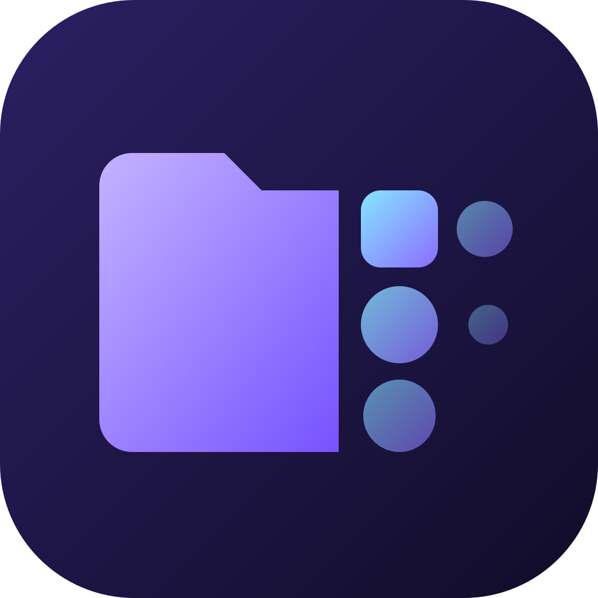

<p align="center">
  
</p>

<h1 align="center">Morfa</h1>

<p align="center">
  Быстрый файловый менеджер для работы с клавиатуры, который умеет конвертировать файлы и работать с облаком.<br>
  Linux · Windows · macOS
</p>

<p align="center">
  <a href="README.md">English</a> · <b>Русский</b>
</p>

<p align="center">
  <a href="https://github.com/Stevfler/morfa/releases/latest">Скачать</a> ·
  <a href="docs/BUILDING.md">Сборка из исходников</a> ·
  <a href="docs/ROADMAP.md">План работ</a>
</p>

---

## Почему Morfa

Название происходит от *morph* — «менять форму». Файловый менеджер переносит файлы с места на место, а Morfa ещё и меняет их формат:
превращает фото в WebP, видео в MP4, документ в PDF, и для этого не нужно открывать отдельную программу.

Morfa появилась, потому что у привычных файловых менеджеров всегда чего-то не хватало:

- **Одна программа на всех системах.** Один и тот же интерфейс, горячие клавиши и возможности на Arch, Ubuntu, Fedora, Windows и macOS. Не нужно отдельно привыкать к Dolphin, Проводнику и Finder.
- **Скорость.** Ядро написано на Rust (Tauri) и работает в лёгком нативном окне, без встроенного браузера. Программа быстро запускается, мало расходует память и без задержек листает огромные папки.
- **Удобно с клавиатуры, привычно мышью.** Есть палитра команд, быстрый переход к папке по части имени, двухпанельный режим с F-клавишами как в Total Commander, и почти любое действие можно отменить.
- **Безопасно по умолчанию.** Удалённое попадает в корзину, копирование ничего не перезаписывает молча, операции можно прервать и отменить. Очистка диска не трогает системные пути.
- **Нужные инструменты встроены.** Конвертация, пакетное переименование, очистка диска, теги и быстрый просмотр уже внутри, так что пять мелких утилит рядом не нужны.
- **Открытый код.** Лицензия GPL-3.0, никакой телеметрии, аккаунт не нужен.

## Возможности

**Навигация**
- Вкладки, двухпанельный режим, восстановление сессии
- Палитра команд (`Ctrl+K`) и быстрый переход к папке (`Ctrl+P`) с учётом того, куда вы ходите чаще и недавно
- Быстрый поиск, по желанию с учётом `.gitignore`
- Быстрый просмотр картинок, текста и офисных документов: зажмите `Пробел`
- Избранное, частые папки, цветные теги (хранятся в метаданных файла)
- Размеры папок по запросу, окно свойств, терминал в текущей папке

**Операции с файлами**
- Копирование и перемещение идут в фоне, с прогрессом и отменой. Существующие файлы молча не перезаписываются.
- Перетаскивание всего выделения
- Отмена и повтор для создания, переименования, перемещения, копирования и удаления в корзину
- Пакетное переименование: поиск и замена, регулярные выражения, шаблоны с нумерацией, смена регистра
- Корзина с восстановлением (Linux, Windows) или кнопкой «Показать в Корзине» (macOS)

**Конвертация**
- Изображения через libvips: JPEG, PNG, WebP, AVIF, HEIC и другие, с настройкой качества и размера и оценкой итогового веса
- Видео и аудио через ffmpeg
- Офисные документы и PDF через модуль Office, который скачивается по запросу
- Все движки поставляются вместе с программой, ничего доустанавливать не нужно

**Диски**
- Экран дисков с заполненностью, подключением, отключением и извлечением
- Неподключённые и зашифрованные (LUKS) диски в Linux открываются по паролю
- Очистка диска для опытных: карта занятого места и категории, системные пути защищены

**Облако**
- Nextcloud: вход через браузер. Morfa получает собственный пароль приложения и не видит ваш.
- Всё облако можно просматривать, ничего не скачивая
- Файлы и папки можно отметить «**Хранить на устройстве**». Они скачиваются в выбранную вами папку и синхронизируются в обе стороны.
- У каждого объекта есть метка: синхронизирован, ожидает, частично на устройстве, только в облаке
- При конфликте сохраняются обе версии, удалённое с любой стороны попадает в корзину
- В планах Яндекс Диск и любой WebDAV

**Внешний вид**
- 6 тем (Midnight, Daylight, Nord, Mocha, OLED, Forest), 8 акцентных цветов, настраиваемые скругления, анимации и плотность строк
- 5 наборов иконок (Lucide, Phosphor, Solar, Fluent, Tabler) и окраска иконок по типу файла, акцентным или своим цветом
- Интерфейс на русском и английском

## Установка

Скачайте пакет для своей системы в разделе [Releases](https://github.com/Stevfler/morfa/releases/latest):

| Система | Файл |
|---|---|
| Windows 10/11 | `*_x64-setup.exe` |
| Ubuntu 22.04 / 24.04, Debian 12 | `*_<дистрибутив>_amd64.deb` |
| Fedora | `*.x86_64.rpm` |
| Arch Linux | `*.pkg.tar.zst` (`sudo pacman -U …`) |
| Любой Linux | `*.AppImage` |

Сборки для macOS пока не публикуются, их можно [собрать из исходников](docs/BUILDING.md).

## Сборка из исходников

```sh
bun install
bun run tauri dev     # запуск в режиме разработки
bun run tauri build   # установщики для вашей ОС
```

Понадобятся [Bun](https://bun.sh), [Rust](https://rustup.rs) и [зависимости Tauri](https://tauri.app/start/prerequisites/). Подробности — в [docs/BUILDING.md](docs/BUILDING.md).

## Участие

Разработка ведётся в приватном GitLab, а этот репозиторий — зеркало только для чтения: каждый пуш и релиз появляются здесь автоматически.
Ошибки и идеи пишите в [Issues](https://github.com/Stevfler/morfa/issues). Pull request'ы не принимаются: зеркало перезаписывается при каждом пуше, поэтому они закрываются автоматически.

## Лицензия

[GPL-3.0](LICENSE) © Stev
